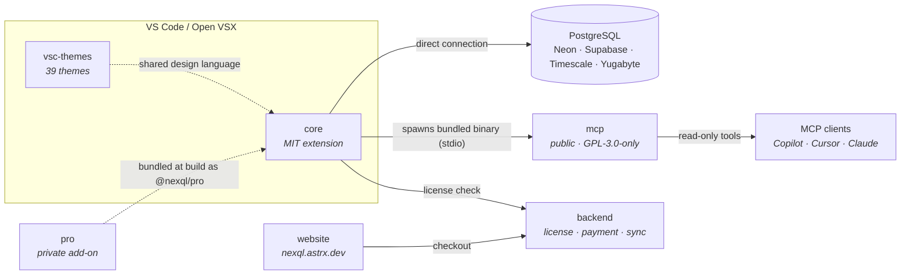

<div align="center">

# NexQL

### Postgres tooling that lives where you code

<em>Notebooks, dashboards, schema design, and AI — inside VS Code, never beside it.</em>

<br/>

[](https://marketplace.visualstudio.com/items?itemName=ric-v.postgres-explorer)
[](https://marketplace.visualstudio.com/items?itemName=ric-v.postgres-explorer)
[](https://marketplace.visualstudio.com/items?itemName=ric-v.postgres-explorer)
[](https://open-vsx.org/extension/ric-v/nexql-themes)
[](https://github.com/NexQL-OSS/core/blob/main/LICENSE)

[**Docs**](https://nexql.astrx.dev/) · [**Themes preview**](https://nexql-themes.astrx.dev/) · [**Issues**](https://github.com/NexQL-OSS/core/issues) · [**support@astrx.dev**](mailto:support@astrx.dev)


<a href="https://www.producthunt.com/products/nexql?embed=true&amp;utm_source=badge-featured&amp;utm_medium=badge&amp;utm_campaign=badge-nexql" target="_blank" rel="noopener noreferrer"></a>

</div>

---

## Mission

```console
nexql=# SELECT mission FROM org;

                                    mission
--------------------------------------------------------------------------------
 Give developers a complete Postgres workflow without ever leaving the editor —
 fast to reach for, safe against production, and honest about what a query will
 do before it runs.
(1 row)
```

---

## Objectives

```console
nexql=# SELECT id, objective, why FROM objectives ORDER BY id;

 id |      objective       |                            why
----+----------------------+------------------------------------------------------------
  1 | Editor-native        | Context switching to a separate GUI costs more than the
    |                      | query itself. The database belongs in the same window.
  2 | Safe by default      | Prod is one dropdown away from dev. Tag it, gate it, warn
    |                      | before the statement, not after the incident.
  3 | AI with real context | Schema-aware assistance beats generic SQL autocomplete.
    |                      | The model should see your tables, not guess them.
  4 | Open core            | The client is MIT and stays MIT. Premium is additive,
    |                      | never a paywall across what already worked.
(4 rows)
```

---

## Principles

```console
nexql=# \d principles
```

| Principle | What it means in practice |
| --- | --- |
| **Vibrancy in the dark** | Near-black and warm-paper foundations with high-contrast syntax. Low eye strain without going gray and lifeless. |
| **Fluid integration** | SQL, data, and application code share one editor and one visual system — no seams between the tools. |
| **Energy and flow** | A cool → warm gradient mirrors scan rhythm: structure first, data last. Color guides the eye without shouting. |
| **Developer-first precision** | Built for real coding nuance — keywords, types, results, errors. Every hue and every affordance earns its place. |
| **Destructive is explicit** | Read-only modes, auto-LIMIT, risk scoring, commit confirmation. Nothing irreversible happens by accident. |
| **Quiet by default** | Chrome stays calm; signal stays loud. One reserved accent for "something is wrong." |

---

## Repositories

```console
nexql=# \dt

              List of relations
     Name      |   Type    | Access  |  License
---------------+-----------+---------+-----------
 core          | extension | public  | MIT
 vsc-themes    | themes    | public  | MIT
 website       | website   | public  | —
 .github       | meta      | public  | Apache-2.0
 mcp           | server    | public  | GPL-3.0-only
 pro           | addon     | private | proprietary
 backend       | api       | private | proprietary
(7 rows)
```

| Repo | What it is |
| --- | --- |
| [**core**](https://github.com/NexQL-OSS/core) | The VS Code extension — explorer, SQL notebooks, dashboard, table designer, safety layer. MIT. [Install ↗](https://marketplace.visualstudio.com/items?itemName=ric-v.postgres-explorer) |
| [**vsc-themes**](https://github.com/NexQL-OSS/vsc-themes) | 39 scenario-anchored color themes — dark, light, OLED, Postgres homage, `Sentinel` prod/staging/dev. MIT. [Install ↗](https://marketplace.visualstudio.com/items?itemName=ric-v.nexql-themes) · [Preview ↗](https://nexql-themes.astrx.dev/) |
| [**website**](https://github.com/NexQL-OSS/website) | The public site and docs behind [nexql.astrx.dev](https://nexql.astrx.dev/). |
| [**.github**](https://github.com/NexQL-OSS/.github) | This profile and org-wide health files. |
| [**mcp**](https://github.com/NexQL-OSS/mcp) | Standalone Postgres MCP server (Rust) — schema-aware, read-only by default, installable in Claude Desktop, Cursor, VS Code Copilot, Zed, and other MCP clients. GPL-3.0-only from v0.2.0 (v0.1.6 and earlier were Apache-2.0). |
| **pro** `private` | Premium add-on — AI chat, in-process MCP server, Plan Studio, backup/restore, schema designer. Builds only against a core checkout. |
| **backend** `private` | License, payment, and cloud-sync API. |

---

## How it fits together



Core ships standalone and stays fully usable on its own. Pro is compiled in only for premium
builds — the free VSIX is CI-verified to contain no premium code. `mcp` is a separate, independently
licensed repo (GPL-3.0-only) — core invokes its binary as a subprocess, keeping the programs separate.

---

## What you get

⚡ **SQL notebooks** · 📊 **live dashboard** · 🌳 **database explorer** · 🏗️ **visual table designer** · 🛡️ **query safety analyzer** · 🤖 **schema-aware AI** · 🔌 **MCP server**

<details>
<summary><b>Query &amp; notebooks</b></summary>

- Interactive SQL notebooks with per-cell connections and AI assistance
- Notebook manager with searchable picker and metadata context
- Saved queries — tag-based organization, connection restore, edit &amp; reuse
- EXPLAIN CodeLens — one-click plan analysis inline
- Advanced result grid — column stats, transpose view, filtering, sliding-window streaming for large `SELECT`s, configurable `bytea` display, in-grid editing with explicit commit confirmation
- Historical query performance tracking with degradation alerts

</details>

<details>
<summary><b>Explore &amp; design</b></summary>

- Tree explorer for tables, views, functions, types, and foreign data wrappers
- Visual table designer — create and edit tables through a full GUI
- Index &amp; constraint manager
- Definition viewer with toggleable SQL preview, copy/edit workflows, routine scaffolding
- Object operations — CRUD, scripts, `VACUUM` / `ANALYZE` / `REINDEX`, plus triggers, sequences, domains, rules, partitions, publications, event triggers, tablespaces, aggregates
- Table intelligence — profile, size, activity monitor, index usage, bloat detection
- Schema intelligence — schema search, index advisor, migration generator

</details>

<details>
<summary><b>Safety</b></summary>

- Environment tagging — 🔴 PROD · 🟡 STAGING · 🟢 DEV, with status-bar risk indicators
- Read-only mode enforcement per connection
- Query safety analyzer with risk scoring before execution
- Auto-LIMIT on `SELECT` (configurable, default 1000 rows)
- Credentials stored in VS Code SecretStorage — never in plaintext settings

</details>

<details>
<summary><b>AI &amp; MCP</b></summary>

- Zero-config NexQL Free AI (Smart / Engineer / Architect tiers), plus GitHub Models, OpenAI, Anthropic, Gemini, and VS Code LM
- Generate, optimize, explain, and analyze with guided follow-ups
- Drag tables, columns, functions, notebooks, or saved queries into the assistant as `@mentions`
- Vision AI — paste or upload images to vision-capable providers
- SQL Assistant in editor tabs, multiple assistant tabs at once
- MCP server — expose your database as read-only tools to Copilot, Cursor, Claude Desktop, and other MCP agents

</details>

<details>
<summary><b>Data movement</b></summary>

- Export results to CSV, JSON, or Excel
- Smart Paste — context-aware clipboard actions for SQL, CSV, and JSON
- Foreign data wrappers — manage foreign servers, user mappings, and foreign tables
- Works with PostgreSQL and Postgres-compatible engines: Neon, Supabase, TimescaleDB, YugabyteDB

</details>

---

## Get started

```console
nexql=# \i install.sql

ext install ric-v.postgres-explorer   -- the extension
ext install ric-v.nexql-themes        -- the themes
```

Or open the Extensions panel and search **NexQL**. Then run `NexQL: Add Connection` and point it at
a database — the explorer, notebooks, and dashboard are available immediately.

---

<div align="center">

**[Documentation](https://nexql.astrx.dev/)** · **[Theme gallery](https://nexql-themes.astrx.dev/)** · **[Report an issue](https://github.com/NexQL-OSS/core/issues)** · **[support@astrx.dev](mailto:support@astrx.dev)**

<sub>core and vsc-themes are MIT. pro and backend are proprietary.<br/>
Built for people who want power, elegance, and speed — all inside the editor.</sub>

```console
nexql=# \q
```

</div>
